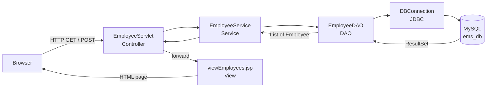
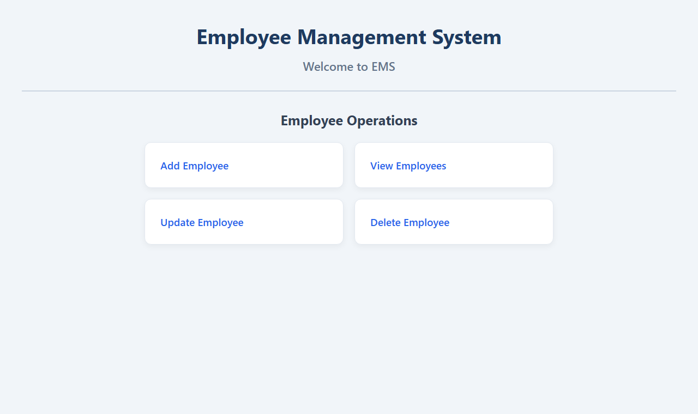
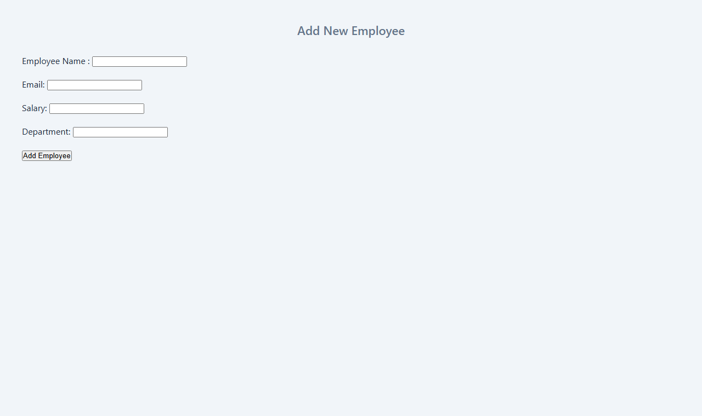
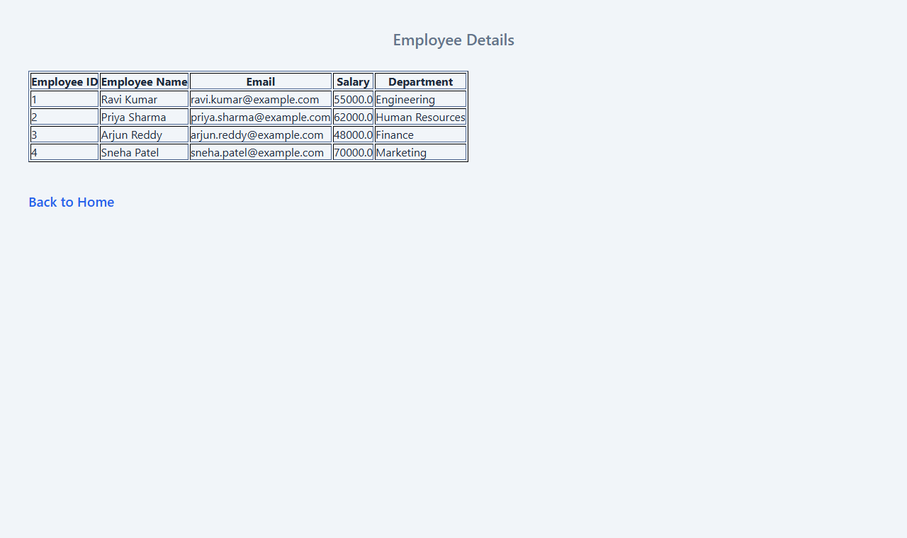
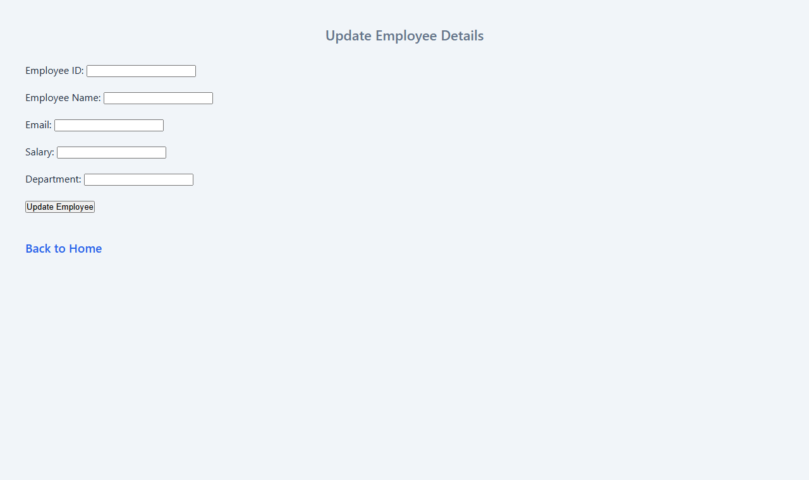
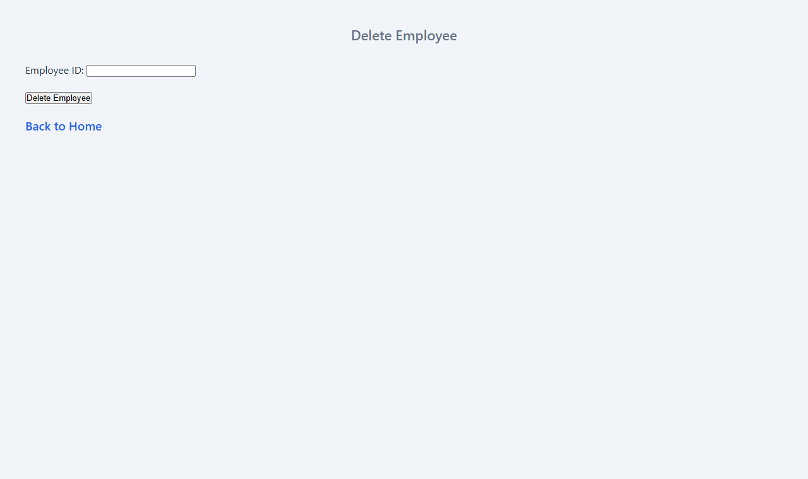
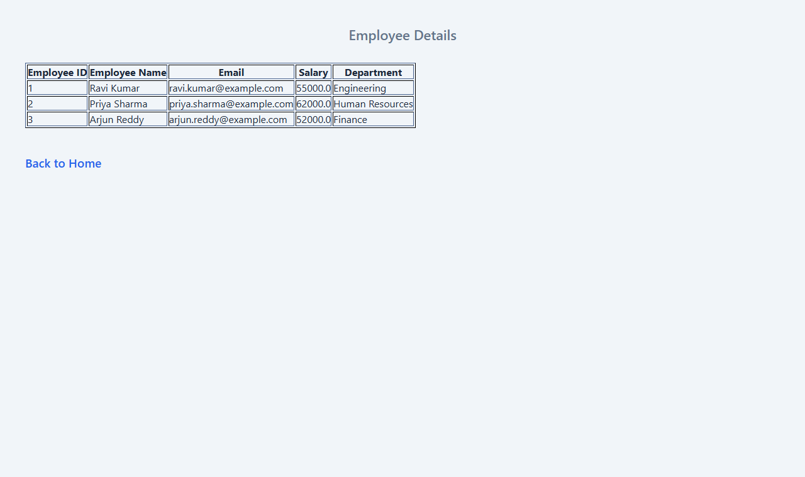

# Employee Management System

A web application for managing employee records, built with Java Servlets, JSP and MySQL.
It lets you add, view, update and delete employees through a simple browser interface.
This project is part of my **Advanced Java** learning, where I practise building web apps with the Servlet API, JDBC and a layered (MVC + DAO) design.

---

## Features

- **Add Employee**: enter name, email, salary and department in a form and save it to the database.
- **View Employees**: see all employees in a table (ID, name, email, salary, department).
- **Update Employee**: change an existing employee's details using their Employee ID.
- **Delete Employee**: remove an employee using their Employee ID.
- **Home page**: a card-style menu linking to all four operations.
- **External DB configuration**: database settings are read from `db.properties` or environment variables, so no credentials are stored in the code.

---

## Tech Stack

| Category        | Technology                                        |
|-----------------|---------------------------------------------------|
| Language        | Java                                              |
| Frontend        | HTML, JSP, CSS                                    |
| Backend         | Jakarta Servlet API 6.0.0                         |
| Database        | MySQL                                             |
| Database access | JDBC with MySQL Connector/J 9.4.0                 |
| Build tool      | Maven (WAR packaging, maven-war-plugin 3.4.0)     |
| Server          | Apache Tomcat 10.1+ (needed for Servlet 6.0 / `jakarta.*`) |
| Java version    | 17                                                |

---

## Architecture

The project follows the **MVC (Model–View–Controller)** pattern with a separate **Service** layer and a **DAO (Data Access Object)** layer:

- **Model**: a plain Java class (`Employee`) that holds employee data.
- **View**: HTML and JSP pages that show forms and results.
- **Controller**: one servlet (`EmployeeServlet`) that receives every request and decides what to do.
- **Service**: passes requests from the controller to the DAO (a place for business rules).
- **DAO**: contains all SQL and talks to the database using JDBC.
- **Utility**: creates database connections.

### Request flow diagram



### How a request flows (example: View Employees)

1. The user clicks **View Employees** on `index.html`, which sends a `GET` request to `/EmployeeServlet`.
2. `EmployeeServlet.doGet()` calls `EmployeeService.displayEmployees()`.
3. The service calls `EmployeeDAO.displayEmployees()`.
4. The DAO gets a connection from `DBConnection.getConnection()` and runs `SELECT * FROM employees` with a `PreparedStatement`.
5. Each row of the `ResultSet` is turned into an `Employee` object and added to a list.
6. The servlet stores the list as a request attribute (`employees`) and forwards to `viewEmployees.jsp`.
7. The JSP loops over the list and builds an HTML table, which is sent back to the browser.

**Add, update and delete** work the same way up to the DAO, but they use `POST`. The servlet reads the `action` parameter (`add`, `update` or `delete`), which comes from the form's submit button, and it writes a short success or failure message straight to the response instead of forwarding to a JSP.

### Layers and files

| Layer      | Class / File                                                                 | Responsibility                                  |
|------------|------------------------------------------------------------------------------|-------------------------------------------------|
| Model      | `com.ems.model.Employee`                                                     | Employee data (id, name, email, salary, department) |
| View       | `index.html`, `addEmployee.html`, `viewEmployees.jsp`, `updateEmployee.jsp`, `deleteEmployee.jsp`, `css/style.css` | Forms, employee table and styling               |
| Controller | `com.ems.controller.EmployeeServlet` (mapped to `/EmployeeServlet`)          | Handles GET (view) and POST (add/update/delete) |
| Service    | `com.ems.service.EmployeeService`                                            | Connects the controller to the DAO              |
| DAO        | `com.ems.dao.EmployeeDAO`                                                    | SQL INSERT, SELECT, UPDATE, DELETE via JDBC     |
| Utility    | `com.ems.util.DBConnection`, `com.ems.util.DBConnectionTest`                 | Opens DB connections; quick connection test     |

---

## Concepts & Theory

This section explains the ideas behind the project's design, what each part is for and how the parts work together.

### What is MVC?

**MVC (Model–View–Controller)** is a design pattern that splits an application into three parts, each with **one job**:

| Part           | Job                                   | Analogy (restaurant)                        |
|----------------|---------------------------------------|---------------------------------------------|
| **Model**      | Holds the data                        | The food / the order details                |
| **View**       | Shows data to the user                | The plate and presentation on the table     |
| **Controller** | Receives requests and decides what to do | The waiter who takes your order and brings food |

**Why use it?**
- **Separation of concerns**: UI code, request-handling code and data code are kept apart.
- **Easier to change**: you can redesign a page without touching the database code, or change the database without touching the pages.
- **Easier to read and debug**: when something breaks, you know which layer to look in.
- **Team-friendly**: one person can work on the JSP pages while another works on the DAO.

In this project, two more layers are added on top of basic MVC: a **Service** layer and a **DAO** layer. A **Utility** class handles connections.

### The layers explained

#### 1. Model: the data
A **Model** is a simple Java class that represents a real-world thing. It has private fields, a constructor, and getters/setters. It has **no logic** for databases or web pages. It just carries data between layers.
This style of class is often called a **POJO** (Plain Old Java Object) or a **JavaBean**.

#### 2. View: what the user sees
The **View** is the user interface: HTML forms and JSP pages.
- **HTML** pages are static. They always look the same (e.g. the Add Employee form).
- **JSP (JavaServer Pages)** pages are dynamic. They can include Java code that runs on the server, so they can show data that changes (e.g. the list of employees from the database). Tomcat turns each JSP into a servlet behind the scenes.

The View should only **display** data. It should not talk to the database.

#### 3. Controller: the traffic manager
The **Controller** is a **Servlet**, a Java class that runs inside a web server (Tomcat) and responds to HTTP requests.
- It **reads** input from the request (`request.getParameter(...)`).
- It **calls** the Service layer to do the work.
- It **decides** what to show next: it either forwards to a JSP or writes a response directly.

The controller does not contain SQL. It only coordinates.

#### 4. Service: the business layer
The **Service** layer sits between the controller and the DAO. It is the place for **business rules**, such as "salary must be positive" or "email must be unique".
In this project it simply passes calls to the DAO, but having it means new rules can be added later **without changing the servlet or the DAO**.

#### 5. DAO: the database layer
**DAO (Data Access Object)** is a pattern where **all database code lives in one class**.
- It contains the SQL (`INSERT`, `SELECT`, `UPDATE`, `DELETE`).
- It converts database rows into Java objects (and Java objects into SQL parameters).
- The rest of the app never writes SQL; it just calls DAO methods like `addEmployee(employee)`.

If the database changes (e.g. MySQL → PostgreSQL), mostly only the DAO needs to change.

#### 6. Utility: shared helpers
A **Utility** class holds reusable code that many classes need. Here, `DBConnection` is the single place that knows **how to connect to MySQL**, so the DAO doesn't repeat connection code in every method.

### How the layers connect

Each layer only talks to the layer **directly next to it**:

```
View (HTML/JSP)  ⇄  Controller (Servlet)  ⇄  Service  ⇄  DAO  ⇄  Utility (JDBC)  ⇄  MySQL
                         ▲                                  ▲
                         └──────── Model (Employee) ────────┘
                         (carries data between all layers)
```

- The **View** sends form data to the **Controller** (via `<form action="EmployeeServlet" method="post">`).
- The **Controller** creates an `Employee` **Model** object from the form data and passes it to the **Service**.
- The **Service** passes it to the **DAO**.
- The **DAO** gets a connection from **DBConnection** and runs SQL using **JDBC**.
- For reads, the DAO turns rows into `Employee` objects and returns them back up the chain.
- The **Controller** puts the data into the request and forwards to a **JSP View**, which displays it.

In code, each layer holds a reference to the next one:

```java
// EmployeeServlet (Controller) → uses the Service
private EmployeeService employeeService = new EmployeeService();

// EmployeeService (Service) → uses the DAO
private EmployeeDAO employeeDAO = new EmployeeDAO();

// EmployeeDAO (DAO) → uses the Utility
Connection con = DBConnection.getConnection();
```

### Purpose of each class and file

#### `com.ems.model.Employee` (Model)
Represents one employee.

| Member | Purpose |
|--------|---------|
| Fields `employeeid`, `employeeName`, `email`, `salary`, `department` | Store the employee's data (match the table columns) |
| `Employee()` | Empty constructor, used by the DAO when reading rows from the database |
| `Employee(id, name, email, salary, department)` | Full constructor, used by the servlet when building an employee from form data |
| Getters / setters | Read and change the fields (used by the DAO and the JSP) |

#### `com.ems.controller.EmployeeServlet` (Controller)
Mapped to the URL `/EmployeeServlet` with `@WebServlet`. It handles all employee requests.

| Method | Purpose |
|--------|---------|
| `doGet()` | Handles **View Employees**: gets the list from the service, stores it as the `employees` request attribute and forwards to `viewEmployees.jsp` |
| `doPost()` | Handles **add**, **update** and **delete**: reads the `action` parameter, reads the form fields, calls the matching service method and writes a success or failure message |

#### `com.ems.service.EmployeeService` (Service)
Middle layer between the controller and the DAO.

| Method | Purpose |
|--------|---------|
| `addEmployee(Employee)` | Passes a new employee to the DAO to insert |
| `updateEmployee(Employee)` | Passes updated details to the DAO |
| `deleteEmployee(int)` | Asks the DAO to delete by ID |
| `displayEmployees()` | Gets the list of all employees from the DAO |

#### `com.ems.dao.EmployeeDAO` (DAO)
All SQL for the `employees` table. Each method opens a connection, runs one query with a `PreparedStatement` and closes everything automatically using **try-with-resources**.

| Method | SQL | Returns |
|--------|-----|---------|
| `addEmployee(Employee)` | `INSERT INTO employees ...` | `true` if a row was inserted |
| `updateEmployee(Employee)` | `UPDATE employees SET ... WHERE employee_id = ?` | `true` if a row was updated |
| `deleteEmployee(int)` | `DELETE FROM employees WHERE employee_id = ?` | `true` if a row was deleted |
| `displayEmployees()` | `SELECT * FROM employees` | `List<Employee>` with every row |

**Why `PreparedStatement`?** The `?` placeholders are filled safely by JDBC, which protects against **SQL injection** and handles quotes and data types automatically.

#### `com.ems.util.DBConnection` (Utility)
Creates database connections.
- Loads the MySQL JDBC driver (`com.mysql.cj.jdbc.Driver`).
- Reads `db.url`, `db.username` and `db.password` from `db.properties`, or from the environment variables `DB_URL`, `DB_USERNAME` and `DB_PASSWORD`.
- Returns a `Connection` using `DriverManager.getConnection(...)`.

#### `com.ems.util.DBConnectionTest` (Utility)
A small class with a `main()` method. Run it to check that the database connection works before starting the web app.

#### View files

| File | Type | Purpose |
|------|------|---------|
| `index.html` | HTML | Home page with links to all four operations |
| `addEmployee.html` | HTML | Form to add an employee (`action=add`) |
| `updateEmployee.jsp` | JSP | Form to update an employee by ID (`action=update`) |
| `deleteEmployee.jsp` | JSP | Form to delete an employee by ID (`action=delete`) |
| `viewEmployees.jsp` | JSP | Reads the `employees` list from the request and shows it in a table |
| `css/style.css` | CSS | Shared styling: card layout for the menu, responsive design for mobile |

#### Configuration files

| File | Purpose |
|------|---------|
| `pom.xml` | Maven build file: sets Java 17, adds the Servlet API and MySQL driver, packages the app as a WAR |
| `db.properties.example` | Template for database settings (copy it to `db.properties`) |
| `.gitignore` | Stops build output, IDE files and `db.properties` from being committed |

### Key terms

| Term | Meaning |
|------|---------|
| **Servlet** | A Java class that handles HTTP requests inside a web server |
| **JSP** | An HTML page that can contain Java code, compiled into a servlet by the server |
| **JDBC** | Java Database Connectivity, the standard Java API for talking to databases |
| **DAO** | Data Access Object, a class that holds all database code for one table/entity |
| **POJO / JavaBean** | A simple Java class with fields, getters and setters |
| **WAR** | Web Application Archive, the packaged file you deploy to Tomcat |
| **Servlet container** | A server (like Tomcat) that runs servlets and JSPs |
| **Request attribute** | Data a servlet attaches to a request so a JSP can read it |
| **RequestDispatcher.forward()** | Passes the request from a servlet to a JSP on the server, without the browser changing URL |

---

## Project Structure

```
01-employee-management-system/
├── pom.xml
├── README.md
├── .gitignore
├── screenshots/          (images used in this README)
└── src/
    └── main/
        ├── java/
        │   └── com/ems/
        │       ├── controller/
        │       │   └── EmployeeServlet.java
        │       ├── dao/
        │       │   └── EmployeeDAO.java
        │       ├── model/
        │       │   └── Employee.java
        │       ├── service/
        │       │   └── EmployeeService.java
        │       └── util/
        │           ├── DBConnection.java
        │           └── DBConnectionTest.java
        ├── resources/
        │   └── db.properties.example
        └── webapp/
            ├── index.html
            ├── addEmployee.html
            ├── viewEmployees.jsp
            ├── updateEmployee.jsp
            ├── deleteEmployee.jsp
            └── css/
                └── style.css
```

> `src/main/resources/db.properties` is created by you locally and is ignored by git.

---

## Database Setup

Run this in MySQL:

```sql
CREATE DATABASE ems_db;

USE ems_db;

CREATE TABLE employees (
    employee_id   INT AUTO_INCREMENT PRIMARY KEY,
    employee_name VARCHAR(100) NOT NULL,
    email         VARCHAR(100) NOT NULL,
    salary        DECIMAL(10, 2) NOT NULL,
    department    VARCHAR(50)  NOT NULL
);
```

`employee_id` must be `AUTO_INCREMENT` because the app does not send an ID when adding a new employee.

---

## How to Run

### Prerequisites

- JDK 17
- Maven
- MySQL Server
- Apache Tomcat 10.1 or newer

### Steps

**1. Clone the repository**

```bash
git clone https://github.com/sriramkumar2/java-learning.git
cd java-learning/adv-java/01-employee-management-system
```

**2. Create the database**

Run the SQL from [Database Setup](#database-setup).

**3. Configure the database connection**

Copy the example file and fill in your own MySQL details:

```bash
cp src/main/resources/db.properties.example src/main/resources/db.properties
```

```properties
db.url=jdbc:mysql://localhost:3306/ems_db
db.username=YOUR_DB_USERNAME
db.password=YOUR_DB_PASSWORD
```

Or set the environment variables `DB_URL`, `DB_USERNAME` and `DB_PASSWORD`; these override the file.

Optional: run `com.ems.util.DBConnectionTest` from your IDE to check that the connection works.

**4. Build the WAR**

```bash
mvn clean package
```

This creates `target/employee-management-system-1.0.0.war`.

**5. Deploy to Tomcat**

Copy the WAR file into Tomcat's `webapps/` folder and start Tomcat.
(Tip: rename it to `employee-management-system.war` first for a shorter URL.)

**6. Open the app**

```
http://localhost:8080/employee-management-system-1.0.0/
```

or, if you renamed the WAR:

```
http://localhost:8080/employee-management-system/
```

---

## Screenshots

These screenshots were taken from the application running on **Apache Tomcat 10.1** with a **MySQL** database.
The sample employees below were added, updated and deleted **through the app's own forms**.

### Home page
The main menu with links to all four operations.



### Add Employee
Form for entering a new employee's name, email, salary and department.



### View Employees
After adding four employees through the Add form, `EmployeeServlet` loads them from MySQL and `viewEmployees.jsp` shows them in a table.



### Update Employee
Form for changing an employee's details by Employee ID.



### Delete Employee
Form for removing an employee by Employee ID.



### Result after Update and Delete
Proof that update and delete work: employee **#3 (Arjun Reddy)** had their salary updated from **48000 → 52000**, and employee **#4 (Sneha Patel)** was deleted.



---

## Future Improvements

- Add **input validation** and friendly error pages (for example, an empty or non-numeric salary currently causes an error).
- Show results on proper **JSP pages** after add, update and delete, instead of plain text messages.
- Add **search** by name or department, and **pagination** for the employee list.
- Add **login and authentication** so only authorised users can manage employees.
- Replace scriptlets in JSP with **JSTL/EL**, and use a **connection pool** instead of opening a new connection per request.

---

## What You Can Learn by Building This Project

This project is a good first step into **Java web development**. Building it from scratch teaches the basics that bigger frameworks like Spring Boot are built on.

### 1. How the web works
- How a browser sends an **HTTP request** and gets an **HTTP response**.
- The difference between **GET** (reading data, e.g. View Employees) and **POST** (sending data, e.g. Add, Update, Delete).
- How **HTML forms** send data to the server using `name` attributes and `request.getParameter()`.

### 2. Servlets and JSP
- How a **Servlet** works and how `@WebServlet` maps a URL to a Java class.
- How one servlet can handle many operations using an `action` parameter.
- How to send data from a servlet to a **JSP** using `request.setAttribute()` and `RequestDispatcher.forward()`.
- How JSP builds dynamic HTML, such as a table that changes with the database.

### 3. Database programming with JDBC
- How to connect Java to **MySQL** using a JDBC driver.
- How to write **CRUD** operations (Create, Read, Update, Delete) in SQL.
- Why **`PreparedStatement`** is safer than building SQL strings (it prevents **SQL injection**).
- How to turn a **`ResultSet`** into Java objects.
- How **try-with-resources** automatically closes connections and avoids resource leaks.

### 4. Clean code and design patterns
- How the **MVC** pattern separates data, UI and request handling.
- Why a **DAO** keeps all SQL in one place.
- Why a **Service layer** is useful even when it starts small.
- How to organise code into **packages** (`model`, `controller`, `service`, `dao`, `util`).

### 5. Build, deploy and run
- How **Maven** manages dependencies (`pom.xml`) and packages the app as a **WAR** file.
- How to deploy a WAR to **Apache Tomcat** and open the app in a browser.
- Why **version compatibility** matters: `jakarta.servlet` 6.0 needs **Tomcat 10.1+** and **Java 17+**, while older Tomcat versions use `javax.servlet`.

### 6. Security and professional habits
- Why passwords should **never be hard-coded** in source code.
- How to keep secrets in a **properties file** or **environment variables**, and hide them from Git with **`.gitignore`**.
- How to provide a safe **example config file** (`db.properties.example`) for other developers.

### 7. Version control and documentation
- How to use **Git and GitHub** to save and share a project.
- How to write a clear **README** with setup steps, architecture and screenshots so others can understand and run your work.

### 8. Debugging and problem solving
While building and running this project, you may face real-world problems like:
- `ClassNotFoundException` when the **JDBC driver** is missing.
- `Unknown database` when the **database is not created** yet.
- The server not starting because a **port is already in use** (e.g. port 8080).
- The app not running because of the **wrong Java version**.

Solving these teaches you how to **read error messages and stack traces**, which is one of the most useful skills for any developer.

### Skills summary

| Area                 | Skills gained                                        |
|----------------------|------------------------------------------------------|
| Backend              | Servlets, request handling, MVC                      |
| Frontend             | HTML forms, JSP, CSS                                 |
| Database             | MySQL, SQL CRUD, JDBC, PreparedStatement             |
| Architecture         | MVC, DAO, Service layer, layered design              |
| Tools                | Maven, Tomcat, Git, GitHub                           |
| Professional habits  | Secure configuration, documentation, debugging       |

> **Next step:** after this project, you are ready to learn **Spring Boot**, which automates much of what was done by hand here (servlets, JDBC, configuration).

---

## Author

**Sriram Kumar**
GitHub: [https://github.com/sriramkumar2](https://github.com/sriramkumar2)
